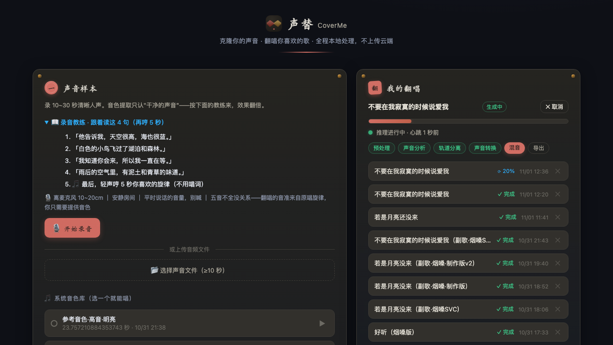

# 🎤 声替 CoverMe（AI 翻唱工坊）

**克隆你自己的声音，翻唱你喜欢的歌。** 全程本地处理，不上传任何云端。



上传/录制一小段你自己的声音 → 选一首喜欢的歌 → 软件自动完成「人声/伴奏分离 → 音色克隆 → 混音母带」，输出"用你的音色唱这首歌"的成品。

## ✨ 功能特性

- **零样本声音克隆**：录 10~30 秒即可克隆音色，无需训练（OpenVoice v2 / Seed-VC）
- **永远可用的兜底引擎**：离线 DSP"音域适配"演示引擎，把原唱音高适配到你的音域
- **高质量人声分离**：Demucs v4；失败自动回退中心声道提取，绝不阻塞；带子进程超时保护
- **分离结果缓存**：同一首歌 + 同一模型只分离一次，调参重跑秒级出结果（LRU 容量上限自动淘汰）
- **智能混音母带**：
  - **静音段清理**——原唱不唱的位置自动压制转换人声，去除句间模型残噪
  - **人声电平自动对齐**——转换后响度自动匹配原唱人声，不同歌不再忽大忽小
  - **人声峰值控制**——对齐后人声瞬时峰值自动软限幅，杜绝写盘硬削波与母带限幅器过载的泵感破音
  - **LUFS 响度归一**——按 ITU-R BS.1770 感知响度归一到 -14 LUFS（流媒体标准），前瞻软限幅防削波
  - **发闷检测**——转换输出高频明显缺失时在处理日志提示更换引擎或调高 tau
- **双入口**：中文 Web 界面（浏览器直接录音）+ 命令行 CLI
- **批量翻唱**：一次拖入多首歌，逐个排队生成，同一设置快速出一系列作品
- **任务系统**：后台队列、实时进度（6 阶段）、随时取消、SQLite 持久化、失败自动降级并记录日志
- **分轨对比**：成品之外可试听原唱人声 / 伴奏 / 转换后人声

## 🚀 快速开始

```bash
cd ~/you-want/ai-cover-studio

# 1) 安装（核心，离线可用）
bash setup.sh

# 2) 安装高质量组件（可选，推荐）：Demucs 分离 + OpenVoice 音色克隆
bash setup.sh --full

# 3) 启动
bash run.sh
# 打开 http://127.0.0.1:8765
```

**使用流程**（网页内）：① 录音或上传声音样本 → ② 拖入歌曲 → ③ 选引擎点"生成翻唱" → ④ 试听/下载。

**命令行**：

```bash
# 查看当前环境可用的引擎/分离器
.venv/bin/python -m app.cli engines

# 生成一首翻唱（tau 越小音色越浓，仅 OpenVoice 生效）
.venv/bin/python -m app.cli cover --song 某歌.mp3 --sample demo/demo_ref.wav --engine auto --out output/ --tau 0.2

# 关闭智能混音（保留原始转换电平）
.venv/bin/python -m app.cli cover --song 某歌.mp3 --sample demo/demo_ref.wav \
    --no-auto-balance --no-denoise-gate

# 一键端到端演示（合成一首测试歌并翻唱）
.venv/bin/python scripts/demo.py --say
```

## 🧩 声音引擎说明

| 引擎 | 原理 | 质量 | 依赖 | 适用 |
|------|------|:---:|------|------|
| **Seed-VC**（实验） | SVC 歌唱模式：F0 条件化保留旋律唱腔 + 音域自动适配 | ★★★★★ | 仓库+权重约 3GB | 对歌曲效果最佳，CPU 一首约 1~3 小时 |
| **OpenVoice v2** | 零样本音色迁移，保留旋律节奏 | ★★★★ | 包+权重约 500MB | 默认推荐，CPU 几十秒~几分钟/曲 |
| **音域适配 pitchfit** | DSP 把原唱音高适配到你的音域+EQ | ★★（演示） | 无（纯离线） | 兜底/快速试听 |

流水线含 **UVR-DeEcho-DeReverb 人声去混响**（转换前烘干分离人声，减少拖影毛刺，
`VC_DEREVEB=0` 可关闭）；引擎与分离器均可在界面中选择，选"自动"则按质量优先级取当前
可用者；任何组件失败都会自动降级并在任务日志中说明。

## 🗂 项目结构

```
app/
├── main.py      # FastAPI + REST API
├── tasks.py     # 翻唱流水线（预处理→分析→分离→转换→混音→导出）+ 任务队列
├── store.py     # SQLite
├── audio/       # io / dsp(WSOLA·基频·响度) / mix
├── separation/  # demucs / center 兜底
├── voice/       # seedvc / openvoice / pitchfit 引擎
└── web/         # 中文单页前端
tests/           # pytest 24 例（含 HTTP 端到端）
scripts/         # demo 素材生成 / OpenVoice 权重下载
docs/PLAN.md     # 完整规划与实施方案
```

## 🔌 API 一览（启动后可访问 /docs 查看交互式文档）

| 方法 | 路径 | 说明 |
|------|------|------|
| GET | `/api/health` | 健康检查 |
| GET | `/api/engines` | 引擎/分离器可用状态 |
| POST | `/api/voice-samples` | 上传声音样本（multipart `file`） |
| GET/DELETE | `/api/voice-samples/{id}` | 列表 / 删除 |
| POST | `/api/covers` | 创建翻唱任务（`song` + `voice_sample_id` + engine/separator/增益/音高/tau/智能混音开关/标题） |
| GET | `/api/covers/{id}` | 任务状态与进度 |
| POST | `/api/covers/{id}/cancel` | 取消任务（排队中立即取消；进行中在阶段边界停止） |
| GET | `/api/covers/{id}/result` | 下载成品（mp3/wav） |
| GET | `/api/covers/{id}/stems/{kind}` | 分轨：`vocals` / `instrumental` / `converted` / `song` |

## ⚙️ 常用配置（环境变量）

| 变量 | 默认 | 说明 |
|------|------|------|
| `VC_PORT` / `VC_HOST` | 8765 / 127.0.0.1 | 服务地址 |
| `VC_MAX_UPLOAD_MB` | 150 | 上传大小上限 |
| `VC_MAX_SONG_MINUTES` | 12 | 歌曲时长上限 |
| `VC_MAX_CONCURRENT_JOBS` | 1 | 并发任务数（CPU 密集，建议 1） |
| `VC_DEMUCS_MODEL` | htdemucs | 分离模型（可换 htdemucs_ft 提升质量） |
| `VC_DEMUCS_TIMEOUT` | 3600 | 分离子进程超时（秒），超时自动走兜底 |
| `VC_SEPARATION_CACHE` | 1 | 分离结果缓存开关（0 关闭） |
| `VC_CACHE_MAX_GB` | 5 | 分离缓存容量上限（GB），超限按最旧淘汰 |
| `VC_SEEDVC_STEPS` | 30 | Seed-VC 扩散步数（越大越慢略越好） |
| `VC_CLOUD_PROVIDER` | （空） | 云端付费 API 引擎：`replicate` / `elevenlabs` |
| `VC_CLOUD_API_KEY` | （空） | 云端 API 密钥（仅存环境变量，不入库不上传） |
| `VC_CLOUD_VOICE_ID` | （空） | ElevenLabs Voice ID 或 Replicate 模型 slug（owner/model[:version]） |
| `VC_CLOUD_EXTRA_JSON` | （空） | Replicate 额外 input 字段（JSON） |
| `HF_ENDPOINT` | https://hf-mirror.com | HuggingFace 镜像 |

**云端付费 API**：配置以上环境变量后，引擎列表会出现"云端 API · 按量付费"。
安全设计：`auto` 模式**永不**自动调用付费引擎——只有你明确选中它才产生计费；
转换结果走同一套混音链（人声总线/电平对齐/母带）。

## ❓ 常见问题

- **引擎显示"不可用"？** 运行 `bash setup.sh --full` 安装可选组件；再用 `.venv/bin/python -m app.cli engines` 查看原因。不装也能用（自动降级为演示引擎 + 中心声道分离）。
- **Seed-VC 首次很慢？** 运行 `.venv/bin/python scripts/download_seedvc.py` 提前下载约 2GB 权重（走 hf-mirror，自动做一次 CPU 验证推理）；之后权重常驻本地、离线可用。CPU 推理一首约 5 分钟（`VC_SEEDVC_STEPS` 越小越快），转换失败会自动回退不影响其他引擎。
- **模型下载慢/失败？** 已默认走 hf-mirror.com 镜像（自动禁用 Xet 协议）；OpenVoice 源码获取在 GitHub 被墙时自动切换加速代理。
- **克隆效果不像？** 先确认样本有效：静音/爆音的录音会直接被拒绝（上传时校验）。用安静环境的**干声**（10~30 秒、无伴奏无混响、正常音量说一段再哼两句）；OpenVoice 的 tau 越小音色越浓；想换音色可试界面里预置的"参考音色"（模型仓库自带的高质量人声），追求细节还原用 Seed-VC（CPU 约数分钟/曲）。
- **本机实测（Intel i7-9750H 纯 CPU）**：Demucs 分离 15 秒歌曲约 40 秒；OpenVoice 音色克隆 15 秒人声约 14 秒；演示引擎秒级。

## ⚠️ 使用声明

请仅使用**本人声音**作为样本；生成结果仅供个人学习与娱乐，请勿用于商业用途，请尊重歌曲版权与他人声音权益，勿制作误导性内容。

## 📄 许可

本仓库代码以 [MIT](LICENSE) 许可发布。可选组件（OpenVoice / Seed-VC / Demucs / UVR 模型等）
在安装或首次运行时按其自身许可下载第三方代码与模型，使用前请确认并遵守对应条款。

## 🧪 开发

```bash
.venv/bin/python -m pytest tests/ -v -p no:hydra_pytest     # 33 个测试（含端到端）
```

> 提示：若 venv 里装有 openvoice 附带的 hydra 包，其 pytest 插件在缺 omegaconf 时会报错，
> 加 `-p no:hydra_pytest` 即可绕过（与本项目代码无关）。
